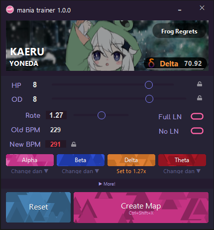
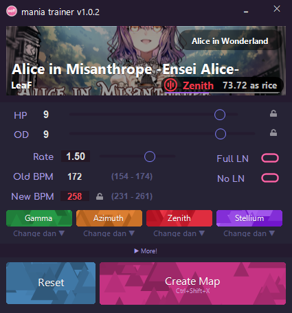
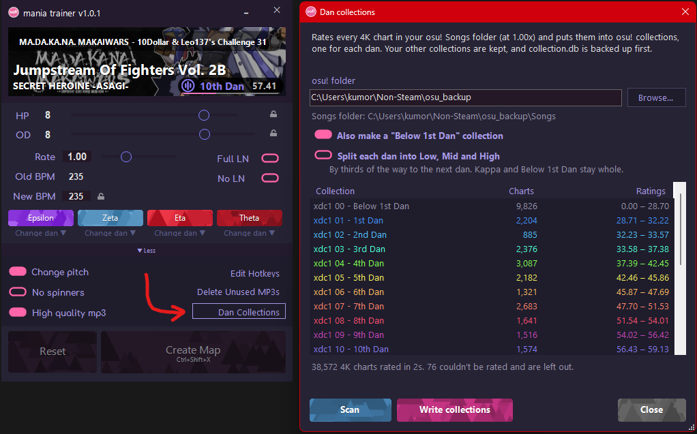

# mania-trainer
A version of [osu-trainer](https://github.com/FunOrange/osu-trainer) 1.8.0 (by FunOrange) for osu!mania 4K and 7K. It shows a beatmap's approximate dan rating, sets the rate a map needs to reach a chosen dan, and can turn every note into a long note (Full LN) or remove all long notes (No LN). 4K maps are rated by the XDC1 difficulty calculator (1st–10th, Alpha–Kappa); 7K maps by rice7, a 7K calculator built on XDC1 that rates rice only (0th–10th, Gamma, Azimuth, Zenith, Stellium).

### Additional Notes
+ Full LN doesn't change the dan rating (how much harder it makes a chart is disputed): a Full LN chart is rated, and the dan buttons set rates, as for the original chart. No LN is counted.
+ **7K** maps are rated by rice7: XDC1 widened to the three and four fingers a hand uses in 7K (those changes aren't TheBagelOfMan's work, see RICE7-LICENSE.txt). It rates rice only: a long note counts as a tap, so a chart with many long notes rates lower than it plays, and No LN makes next to no difference to a 7K rating. When more than 10% of a chart's notes are long notes, its rating is marked "as rice". The dan buttons follow the loaded map's key count and keep their own choices for 4K and for 7K (7K starts with Gamma, Azimuth, Zenith and Stellium); the hotkeys are the same for both. The 7K dan thresholds come from 60 dan practice charts, four per dan (the 4K ones from 246 charts), so take a 7K dan as a rough guide.
+ Maps can be created without alt tabbing with the dan buttons' hotkeys (Alt+Shift+A/S/D/F) and Create Map's (Ctrl+Shift+X)
+ **Dan Collections** (under "More") rates every 4K and 7K chart in your osu! Songs folder at 1.0x and writes osu! (stable) collections, one per dan: `xdc1 01 - 1st Dan` … `xdc1 20 - Kappa` for 4K and `rice7 01 - 0th Dan` … `rice7 15 - Stellium` for 7K, plus `xdc1 00 - Below 1st Dan` and `rice7 00 - Below 0th Dan` if you want them. The 7K collections can be turned off, and 7K charts with more than 10% long notes are left out unless you untick that (rice7 would rate them too low). "Split each dan into Low, Mid and High" divides each dan by thirds of the way to the next dan's threshold (the main window's progress bar): `xdc1 14.1 - Low Delta`, `xdc1 14.2 - Mid Delta`, `xdc1 14.3 - High Delta`; the top dan (Kappa, Stellium) and the Below collections stay whole. Close osu! before writing (osu! saves its collections over the file when it exits). Running it again replaces only the `xdc1 NN - …` and `rice7 NN - …` collections (and the `NN.T` ones of a split, and the `xdc7 NN - …` ones version 1.0.2 wrote, when rice7 was still called xdc7); your other collections are kept and the old `collection.db` is copied to `collection.db.xdc1-backup-<time>`. Ratings are cached in `%LOCALAPPDATA%\mania-trainer`, so later scans only rate new or changed charts.
+ Search "maniatrainer" in osu! to find all your generated maps (they're tagged "osutrainer" too)
+ If you use this application a lot, you can end up using a lot of disk space. (333 mp3s * 3MB/mp3 = 1GB). To free up this space, delete the generated maps in osu, then click the Clean Up button in mania trainer.
+ `tools/calibrate_dans.py` rebuilds the 4K dan thresholds from folders of Dan ~ REFORM ~ beatmaps (Theta, Iota and Kappa come from Dan ~ REFORM ~ FINAL (Ext.)). `tools/calibrate_dans7.py` rates 7K dan practice charts with rice7 and fits the curve the 7K thresholds are read from (`tools/dan7_curve.json`); `tools/rice7_checks.py` checks that rice7 still gives XDC1's rice rating on 4K charts, and `tools/eval7.py` scores it on other labelled charts.

Based on osu-trainer by [FunOrange](https://github.com/FunOrange/osu-trainer). Special thanks to [Craftplacer](https://github.com/Craftplacer) for making the UI really nice and pretty

## Licenses
This project uses the following projects:
- [osu-trainer](https://github.com/FunOrange/osu-trainer), the program this one is built from
- XDC1 by TheBagelOfMan, licensed under the MIT License (see XDC1-LICENSE.txt). rice7.dll is XDC1 with changes for 7K that were made for this program (see RICE7-LICENSE.txt)
- [Font Awesome](https://fontawesome.com/), [licensed under the CC BY 4.0 License](https://creativecommons.org/licenses/by/4.0/)
- [Comfortaa](https://fonts.google.com/specimen/Comfortaa), [licensed under the Open Font License](https://scripts.sil.org/cms/scripts/page.php?site_id=nrsi&id=OFL)
- [osu-resources](https://github.com/ppy/osu-resources), [licensed under the CC BY 4.0 License](https://creativecommons.org/licenses/by-nc/4.0/legalcode)
- [oppai-ng](https://github.com/Francesco149/oppai-ng), [licensed under the Unlicense](https://github.com/Francesco149/oppai-ng/blob/master/UNLICENSE)
- [ProcessMemoryDataFinder](https://github.com/Piotrekol/ProcessMemoryDataFinder), [licensed under GPL-3.0](https://github.com/Piotrekol/ProcessMemoryDataFinder/blob/master/LICENSE)
- [LAME](https://lame.sourceforge.io/)
